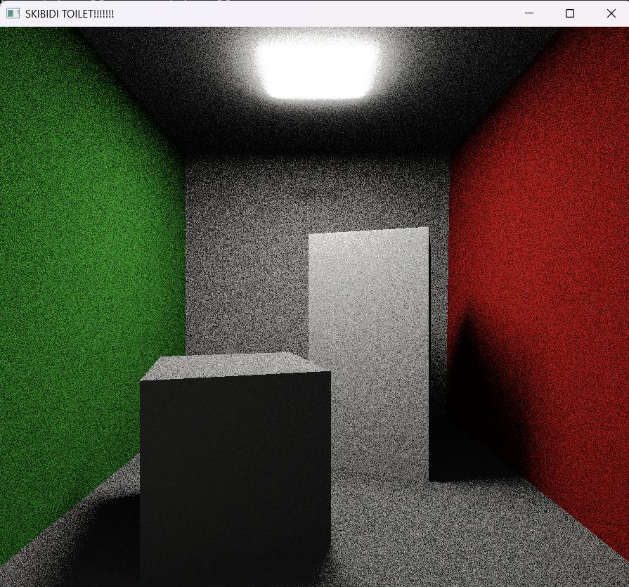

# Raytracer



This project has a corresponding page on [my website](https://derpygamer2142.com/projects/raytracer).

An OpenGL/C++ raytracer that uses GGX-Smith, and has NEE and importance sampling. Main shader is src/shaders/fragment.glsl.

## Running

Linux: You'll need to install glfw3, then you can download the [zip from the releases](https://github.com/derpygamer2142/opengl-raytracer/releases) and run main.

Windows: No installation necessary, hopefully. Download [the zip](https://github.com/derpygamer2142/opengl-raytracer/releases) and run main.exe.

## Building

You'll need to install mingw-32 and glfw3(and build it for mingw-32). Then you should be able to build normally:

```bash
git clone https://github.com/derpygamer2142/opengl-raytracer.git
cd opengl-raytracer
make
```

## Credits

This project uses [stb_image.h](https://github.com/nothings/stb/blob/master/stb_image.h).

The cornell box is from a random sketchfab: https://sketchfab.com/3d-models/cornell-box-original-0d18de8d108c4c9cab1a4405698cc6b6

I also followed a lot of papers and blog posts, the code should have relevant citations.